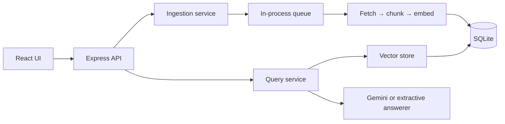

# AI Knowledge Inbox

Save notes or URLs, then ask questions over them. Answers come from a small RAG
pipeline and cite the passages used to produce them.

- **Backend:** Node 20+, Express 5, SQLite (`better-sqlite3`), Google Gemini
- **Frontend:** React 19, Vite, Tailwind CSS, small shadcn-style UI primitives
- **Offline mode:** without `GEMINI_API_KEY`, local embeddings and extractive answers keep the app usable

## Setup

### Requirements

- Node.js 20 or newer
- npm
- A Gemini API key for hosted embeddings and answers (optional)

### Install

```bash
git clone https://github.com/FayazMohammad1/ai-knowledge-inbox.git
cd ai-knowledge-inbox
npm install
npm run install:all
```

The root package only orchestrates commands. Dependencies are intentionally
separate in [`backend/package.json`](backend/package.json) and
[`frontend/package.json`](frontend/package.json), with separate lockfiles.

### Configure Gemini (optional but works best on Gemini API)

```bash
cp backend/.env.example backend/.env
# edit backend/.env:
# GEMINI_API_KEY=your_key
```

With a key, the defaults are `gemini-embedding-001` and `gemini-2.5-flash`.
Without one, the app runs offline with local hashing and extractive answers.

### Run

```bash
npm run dev       # API: http://localhost:4000, UI: http://localhost:5173
```

Open <http://localhost:5173>, add a note or URL, wait for **Ready**, and ask a
question.

### Commands

| Command | Purpose |
|---|---|
| `npm run install:all` | Install backend and frontend dependencies |
| `npm run dev` | Start backend and frontend together |
| `npm test` | Run backend and frontend tests |
| `npm run build` | Build the frontend |
| `npm start` | Start the API only |

All configuration is documented in [`backend/.env.example`](backend/.env.example).


## Architecture



**Ingestion:** `POST /ingest` validates and stores an item as `pending`, then
returns `202`. The queue fetches URLs, chunks text, creates embeddings, and
commits chunks plus `ready` status in one transaction. The UI polls `/items`
only while an item is pending or processing.

**Query:** the question is embedded, relevant vectors are searched by cosine
similarity, and the best passages are sent to a grounded answerer. The response
contains up to three top relevant sources in descending score order, with
`cited` indicating whether the answer referenced each source.

### Project layout

```text
backend/src
  server.js             process lifecycle and graceful shutdown
  container.js          composition root
  app.js                Express wiring
  config.js             environment parsing and defaults
  http/                 routes, schemas, validation, errors, rate limits
  services/             ingestion, query, chunking, retrieval, URL fetching
  embeddings/ llm/      Gemini and offline provider implementations
  queue/                bounded queue and retry/backoff
  repositories/         database access
  db/                   migrations and SQLite connection
frontend/src
  api/client.js         frontend HTTP client
  hooks/                item polling, asking, runtime information
  components/           forms, answer, saved items, status and dialogs
```

Dependencies point inward: routes call services, services call repositories
and providers. Dependencies are injected so tests can use fakes without network
calls.

### Technology constraints

| Layer | Constraint |
|---|---|
| Backend | Node 20+, ESM JavaScript, Express 5, SQLite, no TypeScript build step |
| AI | Gemini is optional; local hashing and extractive answers must keep development offline |
| Frontend | React 19 + Vite, hooks and local component state, Tailwind CSS; no Redux or unnecessary UI framework |
| Integration | Frontend calls the existing HTTP API; scraping, queueing, storage, embeddings, and LLM calls stay server-side

## API

Base URL: `http://localhost:4000`. During development the UI uses `/api`
through the Vite proxy. Every error uses this shape:

```json
{
  "error": {
    "code": "VALIDATION_ERROR",
    "message": "Invalid request",
    "details": [{ "path": "url", "message": "url must be a valid http:// or https:// URL" }],
    "requestId": "5b1c…"
  }
}
```

The same `requestId` is returned in `X-Request-Id` and included in server logs.

### `POST /ingest` → `202 Accepted`

Request (note):

```json
{ "type": "note", "content": "Our retry policy is…", "title": "Retry policy" }
```

Request (URL):

```json
{ "type": "url", "url": "https://example.com/article" }
```

Response:

```json
{
  "item": {
    "id": "uuid",
    "sourceType": "note",
    "title": "Retry policy",
    "status": "pending",
    "sourceUrl": null,
    "chunkCount": 0,
    "preview": "Our retry policy is…",
    "error": null,
    "createdAt": "2026-10-21T08:00:00.000Z",
    "updatedAt": "2026-10-21T08:00:00.000Z"
  }
}
```

The response is immediate (`202`) and includes a `Location` header. Status
moves through `pending → processing → ready | failed`.

### `GET /items?limit=50&offset=0` → `200`

Request:

```http
GET /items?limit=50&offset=0
```

Response:

```json
{
  "items": [
    {
      "id": "uuid",
      "sourceType": "url",
      "title": "Example article",
      "sourceUrl": "https://example.com/article",
      "status": "ready",
      "chunkCount": 3,
      "preview": "First 200 characters…",
      "createdAt": "2026-10-21T08:00:00.000Z",
      "updatedAt": "2026-10-21T08:00:02.000Z"
    }
  ],
  "total": 1,
  "limit": 50,
  "offset": 0
}
```

`GET /items/:id` returns `{ "item": { "...": "rawContent included" } }`.
`DELETE /items/:id` returns `204 No Content`.

### `POST /query` → `200`

Request:

```json
{ "question": "How many times are failed jobs retried?", "topK": 4 }
```

Response:

```json
{
  "answer": "Failed jobs are retried 3 times [1].",
  "sources": [
    {
      "ref": 1,
      "itemId": "uuid",
      "chunkId": "uuid",
      "title": "Retry policy",
      "sourceType": "note",
      "sourceUrl": null,
      "snippet": "Failed jobs are retried 3 times…",
      "score": 0.4821,
      "cited": true
    }
  ],
  "meta": {
    "mode": "llm",
    "model": "gemini-2.5-flash",
    "retrieved": 1,
    "embeddingModel": "gemini-embedding-001",
    "usage": {}
  }
}
```

If nothing passes the relevance threshold, `sources` is empty, `meta.mode` is
`"no-context"`, and the LLM is not called.

### Status codes

| Code | Meaning |
|---|---|
| `200` / `202` / `204` | Success / accepted for background work / deleted |
| `400` | Validation or malformed JSON |
| `404` | Item or route not found |
| `413` | Payload too large |
| `429` | Per-IP rate limit exceeded |
| `502` / `503` | Upstream embedding or LLM failure |
| `500` | Unexpected server error; details are logged, not exposed |

### `GET /health` → `200`

Request:

```http
GET /health
```

Response:

```json
{
  "status": "ok",
  "embeddingModel": "gemini-embedding-001",
  "answerMode": "llm",
  "chatModel": "gemini-2.5-flash",
  "queue": { "active": 0, "waiting": 0, "retrying": 0 }
}
```

## Requirement coverage

| Requirement | Implementation |
|---|---|
| Save notes and URLs | `POST /ingest`; raw content and metadata are stored in SQLite |
| Server-side URL fetching | URL jobs use the fetcher with content-type, size, timeout, redirect, and SSRF checks |
| Chunking and embeddings | Intentional 800-character chunks with overlap; Gemini or offline local embeddings |
| Vector storage and search | Normalized vectors in SQLite; cached exact cosine top-k search |
| RAG answers and citations | Retrieved context is passed to Gemini; responses include cited snippets and scores |
| React frontend | React hooks provide ingestion, item polling, asking, filtering, dialogs, and error states |
| API design | `POST /ingest`, `GET /items`, `POST /query`, `GET /health`, validation, consistent errors |
| Async workflow | `202` ingestion, bounded queue concurrency, retries, persisted status, restart recovery |
| Debuggability | Structured Pino logs, request IDs, timings, clear item errors, sensible HTTP statuses |
| Code quality | Thin routes, injected services, repository-only SQL, focused modules, no authentication or unnecessary infrastructure |

## Design decisions and tradeoffs

| Decision | Why this choice | Tradeoff / alternative |
|---|---|---|
| SQLite | Zero setup, transactional items/chunks, easy local deployment | One writer limits concurrency; move to Postgres when multi-user writes contend |
| Gemini provider interface | Hosted semantic embeddings and answers behind small contracts | Requires API access and has cost/rate limits; offline mode is lexical, not semantic |
| 800-character chunks with 100-character overlap | Keeps passages focused and preserves facts across boundaries | Not fully semantic; add heading-aware or token-aware chunking for complex documents |
| Exact in-memory vector search | Simple and exact at personal-inbox size | Scanning every vector is slow at scale; use pgvector/HNSW or Qdrant |
| In-process queue with SQLite state | Fast `202` responses, bounded concurrency, retries, and restart recovery | Not shared across instances; use BullMQ, SQS, or a Postgres-backed worker queue |
| Polling while work is active | Small, reliable implementation and no connection management | Adds up to 1.5 seconds of UI latency; use SSE/WebSockets for live progress |
| Server-side URL fetching | Keeps scraping and SSRF protections off the browser | Dynamic JavaScript pages may have little readable text; use a controlled browser worker if required |
| Grounded prompts and citations | Reduces unsupported answers and lets users inspect evidence | Citations are model-asserted; add reranking/entailment checks for higher assurance |
| Plain React + Tailwind | Small frontend with no global state or UI framework lock-in | Fewer ready-made primitives; add a component library only when interaction complexity grows |

## What breaks at scale

| Area | What breaks | How to overcome it |
|---|---|---|
| Vector search | RAM and scan time grow with every chunk | Postgres + pgvector/HNSW, Qdrant, or another ANN index |
| Queue | In-memory jobs are not shared across API instances | Separate worker service with BullMQ/SQS/Postgres locking and a dead-letter queue |
| SQLite | Concurrent writes contend | Postgres with connection pooling and migrations |
| Embeddings | Provider quotas and costs slow large imports | Global rate limiting, batching, backpressure, caching, and usage budgets |
| Retrieval quality | Dense search can miss IDs/error codes and return duplicates | Hybrid BM25 + vectors, reranking, MMR, and evaluation data |
| URL ingestion | Dynamic pages and repeated downloads are expensive | Content hashing, refresh scheduling, object storage, and a controlled fetch worker |
| Rate limits | Per-process limits reset and are inconsistent across instances | Shared Redis or gateway-level rate limiting |
| Multi-user security | A shared inbox cannot isolate user data | Authentication, `user_id` on every table/query, tenant limits, and secret management |

## Testing

```bash
npm test
```

The suite covers validation, ingestion, retries, queue concurrency, URL
fetching and SSRF checks, chunking, vector ranking, Gemini adapters, HTTP
errors, rate limits, and frontend citation parsing. Tests use local databases
and fake providers, so they do not require a Gemini key.

Live Gemini calls are not exercised without an API key and network access. For
a manual smoke test, configure `GEMINI_API_KEY`, ask one question, and inspect
`GET /health` plus the response `meta`.
